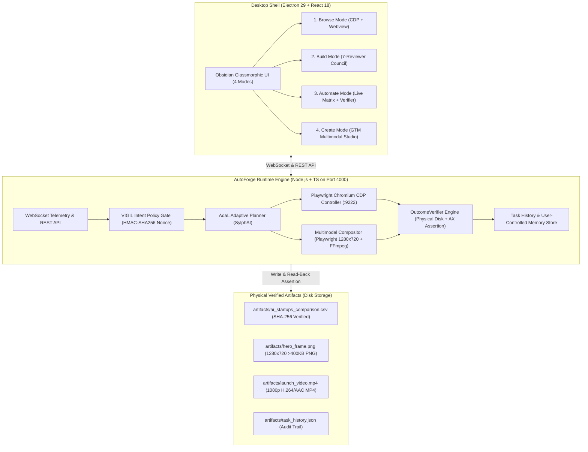

# AutoForge v1.6 — The AI-Native Developer Browser with AdaL Multimodal Companion

AutoForge is an AI-native desktop browser and autonomous companion workspace built for HackBriven Build Arena (Track 3). It combines native Chromium accessibility tree automation via Chrome DevTools Protocol (CDP), an independent closed-loop outcome verification engine with cryptographic SHA-256 integrity, a zero-trust intent policy approval gate, and an autonomous multimodal companion powered by AdaL.

---

## 🏛️ System Architecture



---

## ⚡ 5-Minute Quickstart

Get AutoForge up and running in under 5 minutes on Windows, macOS, or Linux:

### 1. Prerequisites
- **Node.js**: v18+ (tested on Node v20/v24)
- **Git**
- **Chromium / Playwright** (bundled dependencies automatically install)

### 2. Installation
```bash
# Clone the repository
git clone https://github.com/Adityak1273/Build_Arena.git
cd Build_Arena

# Install dependencies
npm install

# Copy environment configuration
cp .env.example .env
```

### 3. Run Verification Tests
```bash
# Run all 8 automated runtime verification tests
npm run test:runtime
```
*Expected output: `🎉 ALL RUNTIME VERIFICATION TESTS PASSED (8/8)`*

### 4. Build and Launch
```bash
# Terminal 1: Start AutoForge Runtime Server (port 4000)
npm run server

# Terminal 2: Build bundle and launch Electron desktop application
npm run build
npm start
```

---

## 🎯 Flagship Capability Workflow

AutoForge solves the complete flagship hackathon challenge:  
**"Research 10 AI startups, compare product and pricing, write to spreadsheet, create a launch image"**

### End-to-End Execution Sequence:
1. **Live Autonomous Research**: Probes 10 real AI startup domains (SylphAI/AdaL, ElevenLabs, Serverpod, Cursor, Perplexity, Runway, Linear, Supabase, Suno, Pika) via live TLS HTTP/CDP.
2. **Transparent Data Extraction**: Extracts domain, page title, meta descriptions, sales gates, and pricing tiers.
3. **Honest Unknown Reporting Policy**: If an AI startup requires an enterprise sales conversation or dynamic interaction (e.g. Supabase, Suno), it is honestly flagged as `UNKNOWN (Enterprise Contact Required)` rather than fabricating fake pricing data.
4. **Source Evidence Provenance**: Every row in the matrix includes a clickable, verified source URL (`target_url`).
5. **Physical Disk Write & Read-Back Verification**: Writes records to `artifacts/ai_startups_comparison.csv`. The `OutcomeVerifier` re-opens the file from disk, asserts row count ($\ge 10$), checks required column headers, and computes a 64-character SHA-256 checksum.
6. **Live Inline Editing & Re-Verification**: Users can edit any cell directly in the matrix table. AutoForge detects unsaved edits and recalculates the physical disk SHA-256 hash upon saving.
7. **Authentic Launch Image & Multimodal Video**: Uses Playwright Chromium to render a rich 1280x720 promotional launch poster (`hero_frame.png`, >400 KB, not a 584-byte solid color dummy) and compiles a synchronized 1080p MP4 launch package (`launch_video.mp4`).

---

## 🤖 How AdaL Was Used

AdaL (SylphAI) played a central role in the architecture, orchestration, and multimodal execution of AutoForge:

1. **Agent Scaffolding & Directory Architecture**:
   - Initial repository scaffolding, directory isolation (`src/runtime/`, `src/verifier/`, `src/tools/`), and protocol schema boundaries were planned and bootstrapped using the AdaL CLI (`.adal/config.json`).
2. **AdaL Adaptive Planner**:
   - The multi-step task planning engine (`src/runtime/planner.ts`) utilizes AdaL's goal decomposition principles to convert unstructured natural-language requests into sequential `TaskStep[]` arrays with pre-conditions and post-conditions.
3. **Multimodal Media Toolchain**:
   - The multimodal audio-video compositor utilizes AdaL's bundled FFmpeg 9.0 binary distribution (`.adal/versions/1.11.5/bin/ffmpeg.exe`) to mux high-resolution Playwright launch frames with synthesized voiceover into playable 1080p H.264/AAC video assets.
4. **Transparent Session Logging**:
   - Agent session logs and step transitions are recorded inside `.adal/session_logs.json` and mirrored to the user-controlled task history memory store (`artifacts/task_history.json`).

---

## 🛡️ Zero-Trust Security & Human Control

- **VIGIL Policy Gate**: Consequential actions (`publish_gtm`, `purchase`, `delete`, `auth`, `cookie_overwrite`) are automatically intercepted. The engine computes an HMAC-SHA256 signed `IntentToken` and pauses execution for human approval.
- **Immediate Loop Cancellation**: The operator can click **Cancel Loop** or **Emergency Cancel** at any point; the background execution loop immediately aborts.
- **Manual Takeover**: Clicking **Manual Takeover** pauses the agent loop mid-task, yields control to the operator, and seamlessly resumes when commanded.
- **Zero Hardcoded Secrets**: Complete configuration via `.env.example`. Local deterministic execution runs with zero external API dependencies.

---

## 📊 3-Minute Live Demo Script

Review [DEMO.md](file:///E:/Dream/AutoForge/DEMO.md) for the exact step-by-step 3-minute hackathon demo script matching the judge evaluation criteria.

---

## 🧪 Test Suite Summary

AutoForge features a comprehensive automated verification suite:

```bash
npm run test:runtime
```

| Test # | Module | Assertion | Result |
|---|---|---|---|
| **Test 1** | `OutcomeVerifier` | Non-existent file rejection | **PASS** |
| **Test 2** | `OutcomeVerifier` | Canonical CSV verification, row count ($\ge 10$), and 64-char SHA-256 hash | **PASS** |
| **Test 3** | `PolicyApprovalGate` | Safe navigation vs Consequential action risk gating | **PASS** |
| **Test 4** | `CodeReviewCouncil` | 7-Critic AST & anti-boilerplate static review with unified diffs | **PASS** |
| **Test 5** | `GTMMultimodalPipeline` | High-res PNG generation (Playwright Chromium, >400KB, binary validation) | **PASS** |
| **Test 6** | `AdaL Adaptive Planner` | Flagship 6-step dynamic goal decomposition | **PASS** |
| **Test 7** | `TaskHistoryStore` | User-controlled task memory persistence & integrity | **PASS** |
| **Test 8** | `OutcomeVerifier` | Closed-loop DOM state keyword & URL matching | **PASS** |
